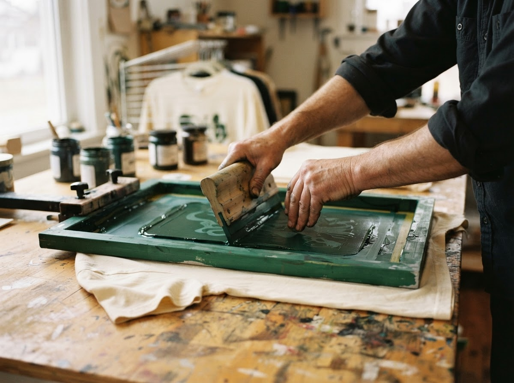
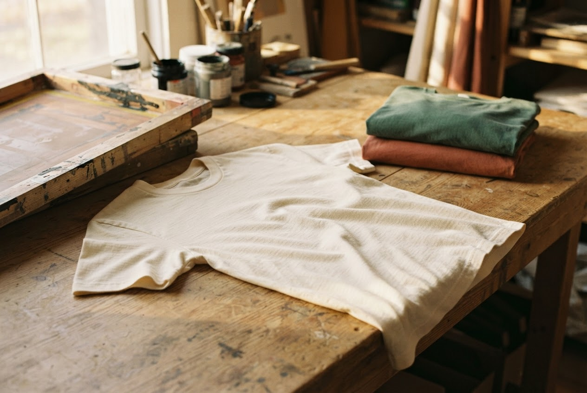

```{=html}
<section class="about-intro">
  <p class="section-label">Our mission / The heart of Salem</p>
  <h1 class="about-heading">More than ink.</h1>
  <p class="about-lede">A small, faith-driven custom apparel business in Chicago, Illinois. We believe the things we wear can carry the things we care about.</p>
</section>

<section class="studio-story">
  <figure class="about-photo">
    
    <figcaption>Small business. Meaningful work. Chicago, Illinois.</figcaption>
  </figure>
  <div class="about-copy">
    <p class="section-label">Custom shirts, made with care.</p>
    <h2 class="section-heading">Every shirt we print carries more than ink — it carries a message.</h2>
    <p>Salem is rooted in faith and a love for bringing people together. We make custom apparel for individuals, churches, events, youth camps, fundraisers, and gifts.</p>
    <p>A message for your community. A shirt for your gathering. A gift with a little extra meaning. Whatever you have in mind, we’re here to help you wear it with purpose.</p>
    <a class="btn-outline" href="https://ig.me/m/salem.csp5" target="_blank" rel="noopener">
      Tell us what you’re making
      
    </a>
  </div>
</section>

<section class="care-in-the-making">
  <div class="about-copy">
    <p class="section-label">From an idea to something you can wear</p>
    <h2 class="section-heading">Good work begins with listening.</h2>
    <p>Tell us the story behind your shirt: who it’s for, what it should say, and when you need it. We’ll work through the details with you, from your design to a confirmed quote.</p>
    <p>Our mission is simple: custom shirts, made with care.</p>
    <a class="btn-light" href="shop.html">
      Explore the shop
      
    </a>
  </div>
  <figure class="about-photo">
    
    <figcaption>The studio table: ideas, cotton, and fresh ink.</figcaption>
  </figure>
</section>

<section class="community-invitation">
  <p class="section-label">Follow along</p>
  <h2 class="section-heading">A little closer to the studio.</h2>
  <p>See what we’re making and the messages behind it. Find Salem on Instagram and Facebook, or read a note from the studio in our <a href="index.html#journal">journal</a>.</p>
  <div class="social-channels">
    <a href="https://www.instagram.com/salem.csp5/" target="_blank" rel="noopener">Instagram ↗</a>
    <a href="https://www.facebook.com/profile.php?id=61590308556408" target="_blank" rel="noopener">Facebook ↗</a>
  </div>
</section>

<section class="newsletter-invitation-band">
  <p class="section-label">Good things, in your inbox</p>
  <h2 class="section-heading">Join the Salem list.</h2>
  <p>New stories, seasonal offers, and a little inspiration from our Chicago studio.</p>
  <a class="btn-outline" href="subscribe.html">
    Count me in
    
  </a>
</section>

<section class="salem-circle">
  <div class="footer-nav">
    <div class="brand-signoff">
      <div class="salem-brand">
        <span class="wordmark">SALEM</span>
        <span class="brand-descriptor">CUSTOM SCREEN<br>PRINTING</span>
      </div>
      <p>Chicago, Illinois<br>Custom shirts, made with care.</p>
    </div>
    <div class="footer-links">
      <div>
        <p class="section-label">Explore</p>
        <a href="shop.html">Shop</a>
        <a href="index.html#journal">The journal</a>
        <a href="about.html">About Salem</a>
        <a href="subscribe.html">Join the Salem list</a>
      </div>
      <div>
        <p class="section-label">Follow along</p>
        <a href="https://www.instagram.com/salem.csp5/" target="_blank" rel="noopener">Instagram ↗</a>
        <a href="https://www.facebook.com/profile.php?id=61590308556408" target="_blank" rel="noopener">Facebook ↗</a>
      </div>
    </div>
  </div>
  <hr class="section-rule">
  <div class="footer-small-print">
    <span>© 2026 Salem Custom Screen Printing</span>
    <span>Made with care. Worn with purpose.</span>
  </div>
</section>

<a class="chat-button" href="https://ig.me/m/salem.csp5" target="_blank" rel="noopener">
  
  Chat with Salem
</a>
```
