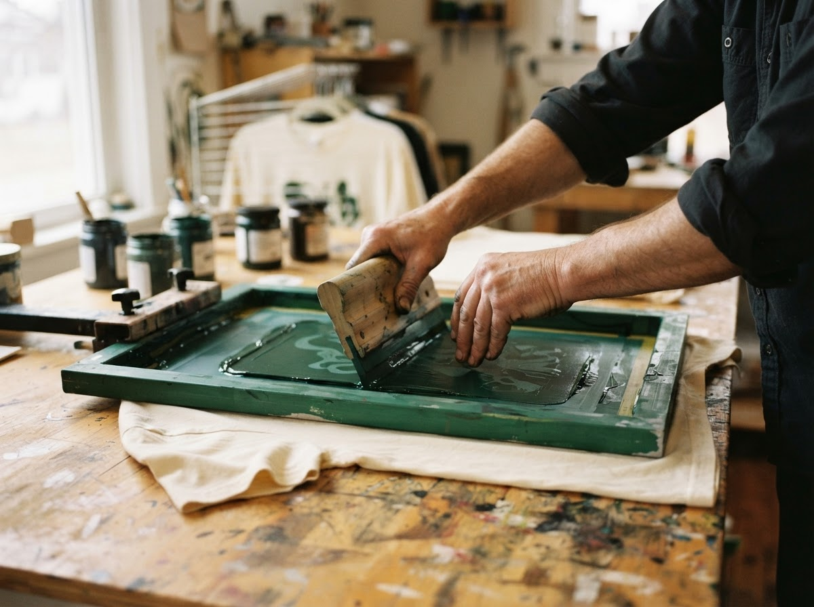
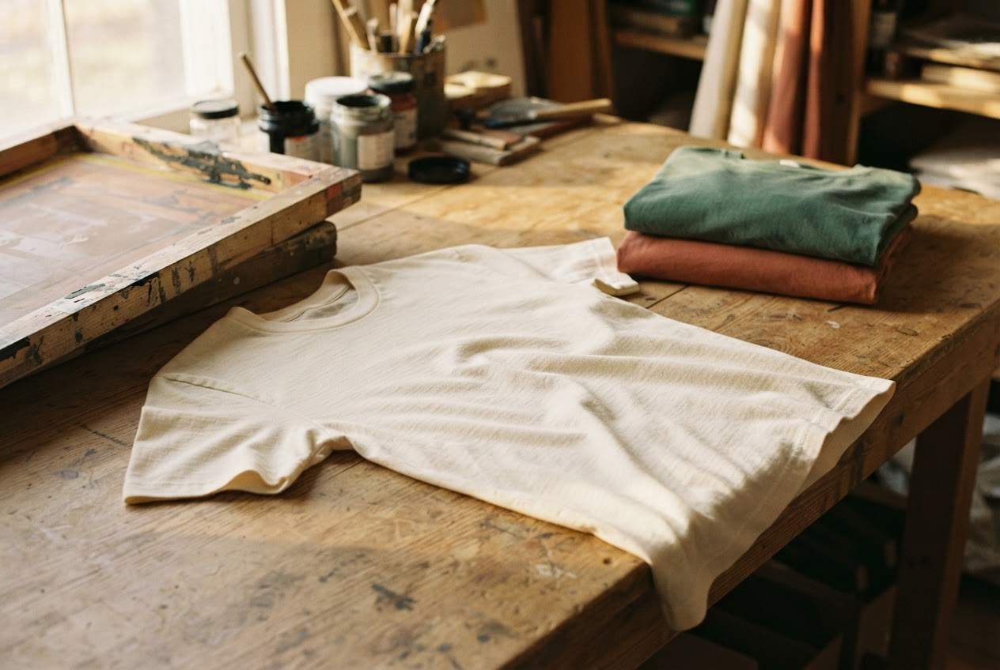

```{=html}
<section class="about-intro">
  <p class="section-label">Nuestra misión / El corazón de Salem</p>
  <h1 class="about-heading">Más que tinta.</h1>
  <p class="about-lede">Un pequeño negocio de ropa personalizada guiado por la fe en Chicago, Illinois. Creemos que lo que vestimos puede llevar lo que nos importa.</p>
</section>

<section class="studio-story">
  <figure class="about-photo">
    
    <figcaption>Un pequeño negocio. Un trabajo con sentido. Chicago, Illinois.</figcaption>
  </figure>
  <div class="about-copy">
    <p class="section-label">Camisetas personalizadas, hechas con cariño.</p>
    <h2 class="section-heading">Cada camiseta que imprimimos lleva más que tinta: lleva un mensaje.</h2>
    <p>Salem está arraigado en la fe y en el amor por unir a las personas. Hacemos ropa personalizada para personas, iglesias, eventos, campamentos juveniles, recaudaciones de fondos y regalos.</p>
    <p>Un mensaje para su comunidad. Una camiseta para su reunión. Un regalo con un poco más de significado. Sea lo que sea que tenga en mente, estamos aquí para ayudarle a llevarlo con propósito.</p>
    <a class="btn-outline" href="https://ig.me/m/salem.csp5" target="_blank" rel="noopener">
      Cuéntenos qué está creando
      
    </a>
  </div>
</section>

<section class="care-in-the-making">
  <div class="about-copy">
    <p class="section-label">De una idea a algo que puede vestir</p>
    <h2 class="section-heading">El buen trabajo empieza por escuchar.</h2>
    <p>Cuéntenos la historia detrás de su camiseta: para quién es, qué debe decir y cuándo la necesita. Trabajaremos los detalles con usted, desde su diseño hasta una cotización confirmada.</p>
    <p>Nuestra misión es sencilla: camisetas personalizadas, hechas con cariño.</p>
    <a class="btn-light" href="shop.html">
      Visite la tienda
      
    </a>
  </div>
  <figure class="about-photo">
    
    <figcaption>La mesa del taller: ideas, algodón y tinta fresca.</figcaption>
  </figure>
</section>

<section class="community-invitation">
  <p class="section-label">Síganos</p>
  <h2 class="section-heading">Un poco más cerca del taller.</h2>
  <p>Vea lo que estamos haciendo y los mensajes detrás de cada pieza. Encuentre a Salem en Instagram y Facebook, o lea una nota del taller en nuestro <a href="index.html#journal">diario</a>.</p>
  <div class="social-channels">
    <a href="https://www.instagram.com/salem.csp5/" target="_blank" rel="noopener">Instagram ↗</a>
    <a href="https://www.facebook.com/profile.php?id=61590308556408" target="_blank" rel="noopener">Facebook ↗</a>
  </div>
</section>

<section class="newsletter-invitation-band">
  <p class="section-label">Cosas buenas, en su correo</p>
  <h2 class="section-heading">Únase a la lista de Salem.</h2>
  <p>Historias nuevas, ofertas de temporada y un poco de inspiración desde nuestro taller en Chicago.</p>
  <a class="btn-outline" href="subscribe.html">
    Inscríbame
    
  </a>
</section>

<section class="salem-circle">
  <div class="footer-nav">
    <div class="brand-signoff">
      <div class="salem-brand">
        <span class="wordmark">SALEM</span>
        <span class="brand-descriptor" lang="en">CUSTOM SCREEN<br>PRINTING</span>
      </div>
      <p>Chicago, Illinois<br>Camisetas personalizadas, hechas con cariño.</p>
    </div>
    <div class="footer-links">
      <div>
        <p class="section-label">Explorar</p>
        <a href="shop.html">Tienda</a>
        <a href="index.html#journal">El diario</a>
        <a href="about.html">Sobre Salem</a>
        <a href="subscribe.html">Únase a la lista de Salem</a>
      </div>
      <div>
        <p class="section-label">Síganos</p>
        <a href="https://www.instagram.com/salem.csp5/" target="_blank" rel="noopener">Instagram ↗</a>
        <a href="https://www.facebook.com/profile.php?id=61590308556408" target="_blank" rel="noopener">Facebook ↗</a>
      </div>
    </div>
  </div>
  <hr class="section-rule">
  <div class="footer-small-print">
    <span>© 2026 Salem Custom Screen Printing</span>
    <span>Hecho con cariño. Llevado con propósito.</span>
  </div>
</section>

<a class="chat-button" href="https://ig.me/m/salem.csp5" target="_blank" rel="noopener">
  
  Escríbale a Salem
</a>
```
