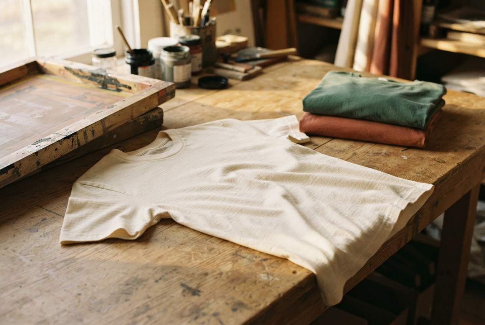
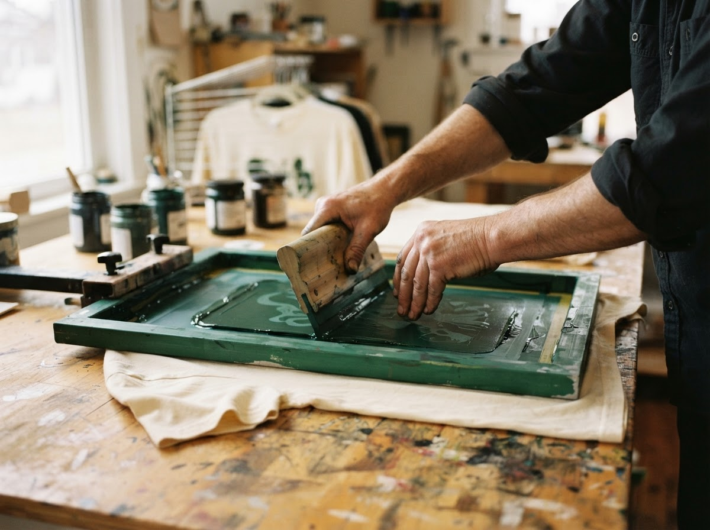

```{=html}
<section class="home-intro">
  <div class="promise">
    <p class="section-label">Un pequeño taller en Chicago. Un poco más de significado.</p>
    <h1 class="hero-heading">Camisetas personalizadas,<br>hechas con cariño.</h1>
  </div>
  <div class="welcome-note">
    <p>Para las personas, las reuniones y los mensajes que importan. Somos un negocio de ropa personalizada guiado por la fe en Chicago, Illinois.</p>
    <a class="journal-invitation" href="#journal">
      
      Un diario de lo que hacemos y por qué
    </a>
  </div>
</section>

<section class="october-special" id="shop">
  <div class="featured-story">
    <div class="apparel-photo">
      
      <span class="caption-badge">TINTA FRESCA. AIRE DE OTOÑO.</span>
    </div>
    <div class="october-offer">
      <p class="section-label">Destacado · Octubre 2026</p>
      <h2 class="offer-title">¡Llegó el otoño!</h2>
      <p class="shirt-price"><span class="price">$16.50</span><span class="price-unit">por camiseta</span></p>
      <div class="offer-details">
        <p class="offer-spec">Su diseño personalizado. Un color de tinta, un lado.</p>
        <p class="offer-minimum">Mínimo 6 camisetas · Sin costo de preparación</p>
        <hr>
        <p class="offer-delivery">Entrega gratis en el área de Chicago<br>Envío gratis en pedidos de $300<br>Producción rápida</p>
      </div>
      <a class="btn-light" href="posts/October-Sale/index.html">
        Vea la oferta de octubre
        
      </a>
    </div>
  </div>
  <div class="feature-footnote">
    <span>Hechas para su próxima reunión, su gran idea o su mensaje de todos los días.</span>
    <span>EL DIARIO DE SALEM / OTOÑO 2026</span>
  </div>
</section>

<section class="how-it-works">
  <p class="section-label">Cómo funciona</p>
  <h2 class="section-heading">Describa, cotice y recoja.</h2>
  <div class="step-cards">
    <div class="step-card">
      <span class="step-badge">01</span>
      <h3>Describa</h3>
      <p>Cuéntenos lo que necesita: diseño, cantidad, tipo de camiseta y fecha límite.</p>
    </div>
    <div class="step-card">
      <span class="step-badge">02</span>
      <h3>Pida una cotización</h3>
      <p>Confirmaremos los detalles, el precio y los tiempos antes de que usted se comprometa.</p>
    </div>
    <div class="step-card">
      <span class="step-badge">03</span>
      <h3>Recoja</h3>
      <p>Una vez aprobado, su pedido se imprime, se empaca y queda listo para recoger.</p>
    </div>
  </div>
  <div class="zelle-note">
    <p class="section-label">Nota sobre el pago con Zelle</p>
    <p>Los datos para pagar con Zelle se comparten después de confirmar su cotización. No se pide ningún pago hasta que el pedido esté aprobado y listo para seguir adelante.</p>
  </div>
</section>

<section class="salem-journal" id="journal">
  <div class="journal-heading">
    <div>
      <p class="section-label">Desde el taller</p>
      <h2 class="section-heading">Un poco de tinta. Mucho corazón.</h2>
    </div>
    <p class="journal-intro">Historias del taller, ofertas de temporada y el propósito detrás de lo que imprimimos.</p>
  </div>
  <div class="journal-controls">
    <div class="category-filters" role="group" aria-label="Filtrar historias por categoría"></div>
    <label class="sort-control">
      <span class="visually-hidden">Ordenar historias</span>
      <select id="sort-post">
        <option value="date-desc">Más recientes primero</option>
        <option value="date-asc">Más antiguas primero</option>
        <option value="title-asc">Título A–Z</option>
        <option value="title-desc">Título Z–A</option>
      </select>
    </label>
  </div>
```

::: {#journal-listing}
:::

```{=html}
</section>

<section class="more-than-ink">
  <figure class="studio-portrait">
    
    <figcaption>Un pequeño negocio. Un trabajo con sentido. Chicago, Illinois.</figcaption>
  </figure>
  <div class="our-purpose">
    <p class="section-label">Nuestra misión / El corazón de Salem</p>
    <h2 class="mission-statement">Cada camiseta que imprimimos lleva más que tinta: lleva un mensaje.</h2>
    <p>Arraigados en la fe y en el amor por unir a las personas, hacemos ropa personalizada para personas, iglesias, eventos, campamentos juveniles, recaudaciones de fondos y regalos. Sea cual sea su mensaje, estamos aquí para ayudarle a llevarlo con propósito.</p>
    <a class="text-link" href="posts/Salems-Mission/index.html">
      Conozca a Salem
      
    </a>
  </div>
</section>

<section class="salem-circle">
  <div class="newsletter-signup">
    <div class="newsletter-invitation">
      <p class="section-label">Cosas buenas, en su correo</p>
      <h2 class="section-heading">Únase a la lista de Salem.</h2>
      <p>Una nota desde nuestro taller: historias nuevas, ofertas de temporada y un poco de inspiración.</p>
    </div>
    <form class="email-form" action="subscribe.html" method="get" data-list-handoff>
      <label for="home-email">Correo electrónico</label>
      <div class="email-row">
        <input type="email" id="home-email" placeholder="usted@ejemplo.com" autocomplete="email" required>
        <button type="submit" class="btn-accent">
          Inscríbame
          
        </button>
      </div>
      <p class="email-reassurance">Solo noticias de Salem. <a href="unsubscribe.html">Puede darse de baja cuando quiera</a>.</p>
    </form>
  </div>
  <hr class="section-rule">
  <div class="footer-nav">
    <div class="brand-signoff">
      <div class="salem-brand">
        <span class="wordmark">SALEM</span>
        <span class="brand-descriptor" lang="en">CUSTOM SCREEN<br>PRINTING</span>
      </div>
      <p>Chicago, Illinois<br>Camisetas personalizadas, hechas con cariño.</p>
    </div>
    <div class="footer-links">
      <div>
        <p class="section-label">Explorar</p>
        <a href="shop.html">Tienda</a>
        <a href="index.html#journal">El diario</a>
        <a href="about.html">Sobre Salem</a>
        <a href="subscribe.html">Únase a la lista de Salem</a>
      </div>
      <div>
        <p class="section-label">Síganos</p>
        <a href="https://www.instagram.com/salem.csp5/" target="_blank" rel="noopener">Instagram ↗</a>
        <a href="https://www.facebook.com/profile.php?id=61590308556408" target="_blank" rel="noopener">Facebook ↗</a>
      </div>
    </div>
  </div>
  <div class="footer-small-print">
    <span>© 2026 Salem Custom Screen Printing</span>
    <span>Hecho con cariño. Llevado con propósito.</span>
  </div>
</section>

<a class="chat-button" href="https://ig.me/m/salem.csp5" target="_blank" rel="noopener">
  <span class="chat-icon"></span>
  Escríbale a Salem
</a>

<script src="../assets/js/config.js?v=2026-11-16b"></script>
<script src="../assets/js/subscriber-store.js?v=2026-11-16b"></script>
<script src="../assets/js/journal-page.js?v=2026-11-16b"></script>
```
