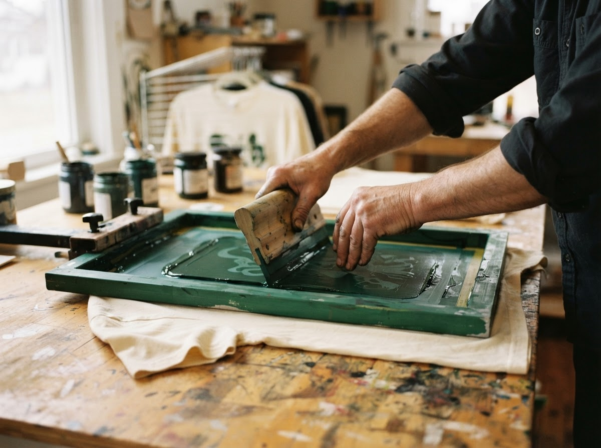

```{=html}
<section class="newsletter-page">
  <div class="newsletter-story">
    <p class="section-label">Cosas buenas, en su correo</p>
    <h1 class="about-heading">Quédese en el círculo de Salem.</h1>
    <p class="about-lede">Una nota desde nuestro taller: historias nuevas, ofertas de temporada y un poco de inspiración. Cuéntenos qué le interesa.</p>
    <figure class="about-photo">
      
      <figcaption>De nuestro pequeño taller en Chicago a su correo.</figcaption>
    </figure>
    <h2 class="story-subheading">Un poco de tinta. Mucho corazón.</h2>
    <p class="story-copy">Elija sus intereses para que sepamos qué le importa. Puede darse de baja de los correos cuando quiera.</p>
    <ul class="list-perks">
      <li><strong>¿Primera vez con Salem?</strong> Ofertas de temporada, historias del taller y un primer vistazo a los diseños nuevos.</li>
      <li><strong>¿Ya imprimió con nosotros?</strong> Aviso anticipado cuando abramos pedidos personalizados y pedidos repetidos fáciles para su grupo.</li>
    </ul>
  </div>

  <div class="signup-card">
    <div class="signup-form-view" id="signup-form-view">
      <div class="audience-toggle" role="radiogroup" aria-label="¿Cuál le describe mejor?">
        <label><input type="radio" name="audience" value="new" checked> Es mi primera vez</label>
        <label><input type="radio" name="audience" value="returning"> Ya he hecho pedidos</label>
      </div>

      <h2 class="signup-heading" id="signup-heading">Únase a la lista de Salem.</h2>
      <p class="signup-intro" id="signup-intro">El nombre y el correo son obligatorios. Todo lo demás es opcional.</p>

      <div class="list-notice" id="list-notice" role="status" tabindex="-1" data-tone="none">
        <p class="list-notice-title" id="list-notice-title"></p>
        <p class="list-notice-copy" id="list-notice-copy"></p>
        <div class="list-notice-actions" id="list-notice-actions" hidden>
          <button type="button" class="btn-outline" id="resend-link">Enviarme mi enlace de preferencias</button>
          <a class="list-text-link" href="index.html#journal">Lea las historias más recientes del taller ↗</a>
        </div>
      </div>

      <form id="sub-form" class="signup-form" novalidate>
        <!-- Trampa para spam: las personas no la ven ni la llenan; los bots sí. -->
        <div class="list-honeypot" aria-hidden="true">
          <label for="website">Sitio web</label>
          <input type="text" id="website" name="website" tabindex="-1" autocomplete="off">
        </div>
        <div class="field-pair">
          <div class="form-field">
            <label for="first">Nombre</label>
            <input class="field-input" type="text" id="first" name="first" autocomplete="given-name" placeholder="Nombre" required>
          </div>
          <div class="form-field">
            <label for="last">Apellido</label>
            <input class="field-input" type="text" id="last" name="last" autocomplete="family-name" placeholder="Apellido" required>
          </div>
        </div>

        <div class="form-field">
          <label for="email">Correo electrónico</label>
          <input class="field-input" type="email" id="email" name="email" autocomplete="email" placeholder="usted@ejemplo.com" required>
        </div>

        <div class="form-field">
          <label for="phone">Teléfono <span class="field-optional">(opcional)</span></label>
          <input class="field-input" type="tel" id="phone" name="phone" autocomplete="tel" placeholder="(555) 123-4567">
        </div>

        <fieldset class="form-field">
          <legend>Cumpleaños <span class="field-optional">(opcional · solo mes y día)</span></legend>
          <div class="field-pair">
            <select class="field-input" id="bmonth" name="bmonth" aria-label="Mes de cumpleaños">
              <option value="">Mes</option>
              <option value="January">Enero</option><option value="February">Febrero</option><option value="March">Marzo</option>
              <option value="April">Abril</option><option value="May">Mayo</option><option value="June">Junio</option>
              <option value="July">Julio</option><option value="August">Agosto</option><option value="September">Septiembre</option>
              <option value="October">Octubre</option><option value="November">Noviembre</option><option value="December">Diciembre</option>
            </select>
            <input class="field-input" type="number" id="bday" name="bday" min="1" max="31" inputmode="numeric" placeholder="Día" aria-label="Día de cumpleaños">
          </div>
        </fieldset>

        <fieldset class="form-field">
          <legend>Me interesa</legend>
          <div class="interest-chips">
            <label><input type="checkbox" name="interest" value="Individual shirts"><span>Camisetas individuales</span></label>
            <label><input type="checkbox" name="interest" value="Team and group orders"><span>Pedidos para equipos y grupos</span></label>
            <label><input type="checkbox" name="interest" value="Church and youth events"><span>Eventos de iglesia y de jóvenes</span></label>
            <label><input type="checkbox" name="interest" value="Fundraisers"><span>Recaudación de fondos</span></label>
            <label><input type="checkbox" name="interest" value="Personal gifts"><span>Regalos personales</span></label>
            <label><input type="checkbox" name="interest" value="Other events"><span>Otros eventos</span></label>
          </div>
        </fieldset>

        <div class="form-field" data-audience="new">
          <label for="source">¿Cómo se enteró de Salem? <span class="field-optional">(opcional)</span></label>
          <select class="field-input" id="source" name="source">
            <option value="">Elija una opción</option>
            <option value="Friend or family">Un amigo o familiar</option>
            <option value="Church or event">La iglesia o un evento</option>
            <option value="Instagram">Instagram</option>
            <option value="Facebook">Facebook</option>
            <option value="LinkedIn">LinkedIn</option>
            <option value="Other">Otro</option>
          </select>
        </div>

        <div class="form-field" data-audience="returning" hidden>
          <label for="past-order">¿Qué ha impreso con nosotros? <span class="field-optional">(opcional)</span></label>
          <input class="field-input" type="text" id="past-order" name="past_order" placeholder="p. ej., camisetas del campamento de otoño, 2025">
          <p class="field-hint">Nos ayuda a preparar su próximo pedido con el mismo diseño y las mismas tallas.</p>
        </div>

        <label class="consent-check" for="consent">
          <input type="checkbox" id="consent" name="consent" required>
          <span>Acepto recibir correos de Salem Custom Screen Printing y entiendo que puedo darme de baja en cualquier momento.</span>
        </label>

        <button type="submit" class="btn-accent signup-submit">
          <span id="signup-submit-label">Unirme a la lista de Salem</span>
          
        </button>
        <p class="field-hint">Solo noticias de Salem. <a class="list-text-link" href="unsubscribe.html">Puede darse de baja cuando quiera</a>. Su teléfono y su cumpleaños son opcionales.</p>
        <p class="form-error" id="form-error" role="alert"></p>
      </form>
    </div>

  </div>
</section>

<section class="salem-circle">
  <div class="footer-nav">
    <div class="brand-signoff">
      <div class="salem-brand">
        <span class="wordmark">SALEM</span>
        <span class="brand-descriptor" lang="en">CUSTOM SCREEN<br>PRINTING</span>
      </div>
      <p>Chicago, Illinois<br>Camisetas personalizadas, hechas con cariño.</p>
    </div>
    <div class="footer-links">
      <div>
        <p class="section-label">Explorar</p>
        <a href="shop.html">Tienda</a>
        <a href="index.html#journal">El diario</a>
        <a href="about.html">Sobre Salem</a>
        <a href="subscribe.html">Únase a la lista de Salem</a>
      </div>
      <div>
        <p class="section-label">Síganos</p>
        <a href="https://www.instagram.com/salem.csp5/" target="_blank" rel="noopener">Instagram ↗</a>
        <a href="https://www.facebook.com/profile.php?id=61590308556408" target="_blank" rel="noopener">Facebook ↗</a>
      </div>
    </div>
  </div>
  <hr class="section-rule">
  <div class="footer-small-print">
    <span>© 2026 Salem Custom Screen Printing</span>
    <span>Hecho con cariño. Llevado con propósito.</span>
  </div>
</section>

<a class="chat-button" href="https://ig.me/m/salem.csp5" target="_blank" rel="noopener">
  
  Escríbale a Salem
</a>

<script src="../assets/js/config.js?v=2026-11-16b"></script>
<script src="../assets/js/subscriber-store.js?v=2026-11-16b"></script>
<script src="../assets/js/subscribe-page.js?v=2026-11-16b"></script>
```
