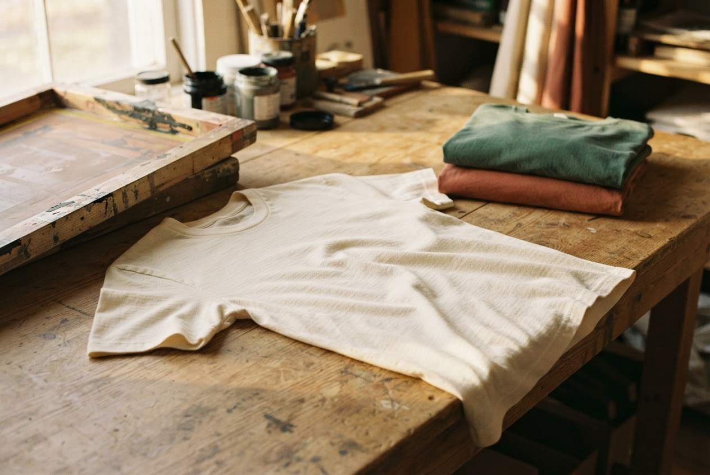
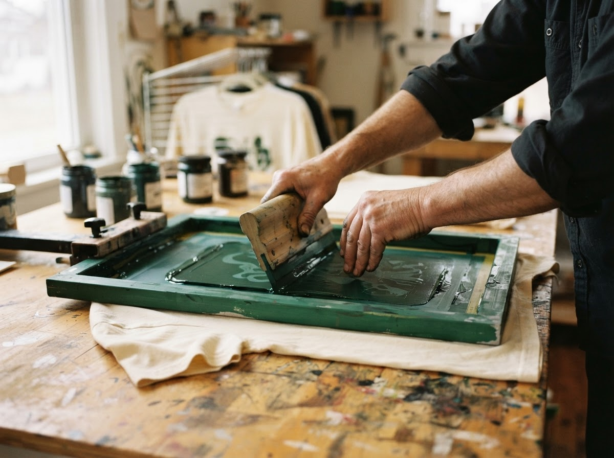

```{=html}
<section class="home-intro">
  <div class="promise">
    <p class="section-label">A small Chicago studio. A little more meaning.</p>
    <h1 class="hero-heading">Custom shirts,<br>made with care.</h1>
  </div>
  <div class="welcome-note">
    <p>For the people, gatherings, and messages that matter. We’re a faith-driven custom apparel business in Chicago, Illinois.</p>
    <a class="journal-invitation" href="#journal">
      
      A journal of what we’re making &amp; why
    </a>
  </div>
</section>

<section class="october-special" id="shop">
  <div class="featured-story">
    <div class="apparel-photo">
      
      <span class="caption-badge">FRESH INK. FALL FEELING.</span>
    </div>
    <div class="october-offer">
      <p class="section-label">Featured · October 2026</p>
      <h2 class="offer-title">Fall is here!</h2>
      <p class="shirt-price"><span class="price">$16.50</span><span class="price-unit">per shirt</span></p>
      <div class="offer-details">
        <p class="offer-spec">Your custom design. One ink color, one side.</p>
        <p class="offer-minimum">Minimum 6 T-shirts · No setup fee</p>
        <hr>
        <p class="offer-delivery">Free delivery in the Chicago area<br>Free shipping on $300 orders<br>Fast turnaround</p>
      </div>
      <a class="btn-light" href="posts/October-Sale/index.html">
        Explore the October sale
        
      </a>
    </div>
  </div>
  <div class="feature-footnote">
    <span>Made for your next gathering, big idea, or everyday message.</span>
    <span>THE SALEM JOURNAL / FALL 2026</span>
  </div>
</section>

<section class="how-it-works">
  <p class="section-label">How it works</p>
  <h2 class="section-heading">Describe, quote, and pick up.</h2>
  <div class="step-cards">
    <div class="step-card">
      <span class="step-badge">01</span>
      <h3>Describe</h3>
      <p>Tell us what you need: design, quantity, shirt type, and deadline.</p>
    </div>
    <div class="step-card">
      <span class="step-badge">02</span>
      <h3>Get a quote</h3>
      <p>We’ll confirm details, pricing, and timing before you commit.</p>
    </div>
    <div class="step-card">
      <span class="step-badge">03</span>
      <h3>Pick up</h3>
      <p>Once approved, your order is printed, packed, and ready for pickup.</p>
    </div>
  </div>
  <div class="zelle-note">
    <p class="section-label">Zelle payment note</p>
    <p>Zelle payment details are shared after your quote is confirmed. No payment is requested until the order is approved and ready to move forward.</p>
  </div>
</section>

<section class="salem-journal" id="journal">
  <div class="journal-heading">
    <div>
      <p class="section-label">From the studio</p>
      <h2 class="section-heading">A little ink. A lot of heart.</h2>
    </div>
    <p class="journal-intro">Studio stories, seasonal specials, and the purpose behind what we print.</p>
  </div>
  <div class="journal-controls">
    <div class="category-filters" role="group" aria-label="Filter stories by category"></div>
    <label class="sort-control">
      <span class="visually-hidden">Sort stories</span>
      <select id="sort-post">
        <option value="date-desc">Newest first</option>
        <option value="date-asc">Oldest first</option>
        <option value="title-asc">Title A–Z</option>
        <option value="title-desc">Title Z–A</option>
      </select>
    </label>
  </div>
```

::: {#journal-listing}
:::

```{=html}
</section>

<section class="more-than-ink">
  <figure class="studio-portrait">
    
    <figcaption>Small business. Meaningful work. Chicago, Illinois.</figcaption>
  </figure>
  <div class="our-purpose">
    <p class="section-label">Our mission / The heart of Salem</p>
    <h2 class="mission-statement">Every shirt we print carries more than ink — it carries a message.</h2>
    <p>Rooted in faith and a love for bringing people together, we make custom apparel for individuals, churches, events, youth camps, fundraisers, and gifts. Whatever your message, we’re here to help you wear it with purpose.</p>
    <a class="text-link" href="posts/Salems-Mission/index.html">
      Get to know Salem
      
    </a>
  </div>
</section>

<section class="salem-circle">
  <div class="newsletter-signup">
    <div class="newsletter-invitation">
      <p class="section-label">Good things, in your inbox</p>
      <h2 class="section-heading">Join the Salem list.</h2>
      <p>A note from our studio — new stories, seasonal offers, and a little inspiration.</p>
    </div>
    <form class="email-form" action="subscribe.html" method="get" data-list-handoff>
      <label for="home-email">Email address</label>
      <div class="email-row">
        <input type="email" id="home-email" placeholder="you@example.com" autocomplete="email" required>
        <button type="submit" class="btn-accent">
          Count me in
          
        </button>
      </div>
      <p class="email-reassurance">Just Salem news. <a href="unsubscribe.html">Unsubscribe anytime</a>.</p>
    </form>
  </div>
  <hr class="section-rule">
  <div class="footer-nav">
    <div class="brand-signoff">
      <div class="salem-brand">
        <span class="wordmark">SALEM</span>
        <span class="brand-descriptor">CUSTOM SCREEN<br>PRINTING</span>
      </div>
      <p>Chicago, Illinois<br>Custom shirts, made with care.</p>
    </div>
    <div class="footer-links">
      <div>
        <p class="section-label">Explore</p>
        <a href="shop.html">Shop</a>
        <a href="#journal">The journal</a>
        <a href="about.html">About Salem</a>
        <a href="subscribe.html">Join the Salem list</a>
      </div>
      <div>
        <p class="section-label">Follow along</p>
        <a href="https://www.instagram.com/salem.csp5/" target="_blank" rel="noopener">Instagram ↗</a>
        <a href="https://www.facebook.com/profile.php?id=61590308556408" target="_blank" rel="noopener">Facebook ↗</a>
      </div>
    </div>
  </div>
  <div class="footer-small-print">
    <span>© 2026 Salem Custom Screen Printing</span>
    <span>Made with care. Worn with purpose.</span>
  </div>
</section>

<a class="chat-button" href="https://ig.me/m/salem.csp5" target="_blank" rel="noopener">
  <span class="chat-icon"></span>
  Chat with Salem
</a>

<script src="assets/js/config.js?v=2026-11-16b"></script>
<script src="assets/js/subscriber-store.js?v=2026-11-16b"></script>
<script src="assets/js/journal-page.js?v=2026-11-16b"></script>
```
