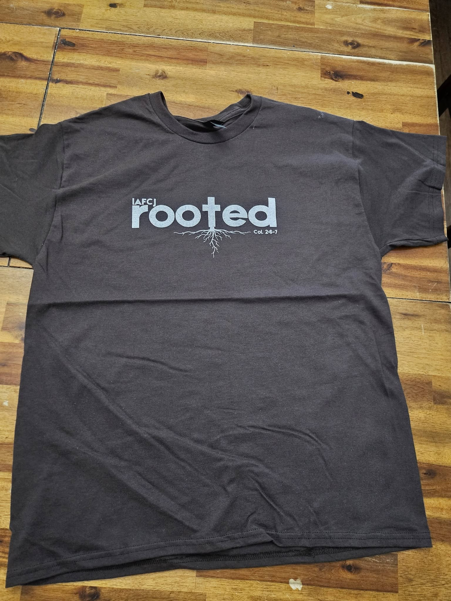
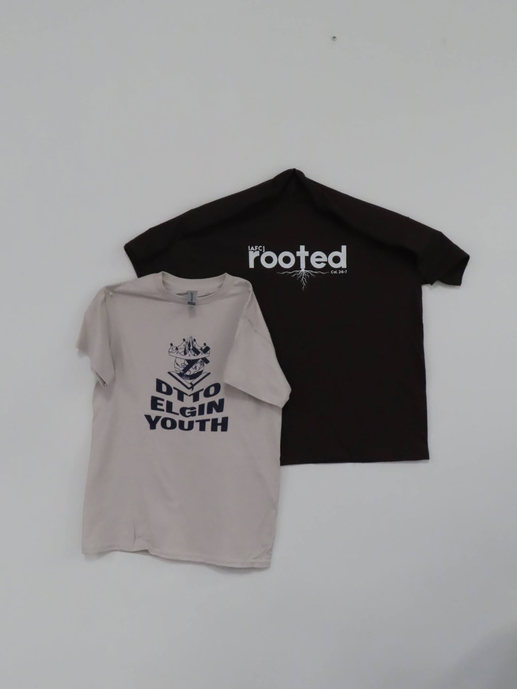

::: {.verse-banner .post-wide}
[Colossians 2:6–7]{.section-label}

“As ye have therefore received Christ Jesus the Lord, so walk ye in him: rooted and built up in him, and stablished in the faith.”
:::

Roots matter. Before anything can grow tall, it has to grow deep. That's the heart behind Rooted, our pre-youth camp event based on Colossians 2:6–7, where we focused on staying grounded in Christ and being built up in our faith.

::::: {.rooted-feature .post-wide}
::: {.post-photo .is-tall}
{fig-alt="Charcoal Rooted event t-shirt laid flat on a wooden floor"}
:::

::: feature-copy
[The shirt]{.section-label}

### Grow deep before you grow tall.

We designed and printed the Rooted tee as a reminder of the event's theme, something to keep wearing long after camp.

- **Event** Pre-youth camp
- **Theme** Colossians 2:6–7
- **Made in** Chicago, Illinois
:::
:::::

::::::: {.scrapbook .post-wide}
[From the event]{.section-label}

### Moments from Rooted

:::::: scrapbook-grid
::: {.post-photo .is-square}
{fig-alt="A black Rooted tee and a grey DYTO Elgin Youth tee hanging on a wall"}
:::

::: {.post-photo .is-square}
{fig-alt="A moment from the Rooted event"}
:::

::: {.post-photo .is-square}
{fig-alt="A moment from the Rooted event"}
:::

::: {.post-photo .is-square}
{fig-alt="A moment from the Rooted event"}
:::
::::::
:::::::

::: post-signoff
**Planning a camp, retreat, or church event?**

We'd love to help your group wear what you believe.

[Start a design](../../shop.html){.btn-accent} [Chat with Salem](https://ig.me/m/salem.csp5){.btn-outline}
:::
