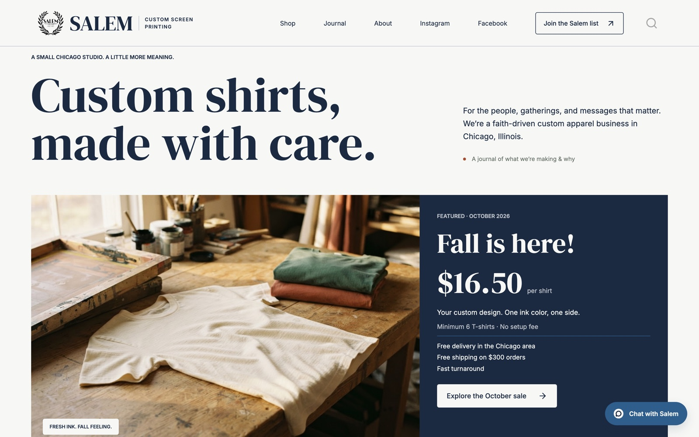
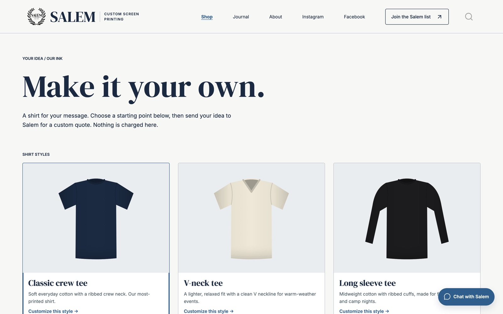
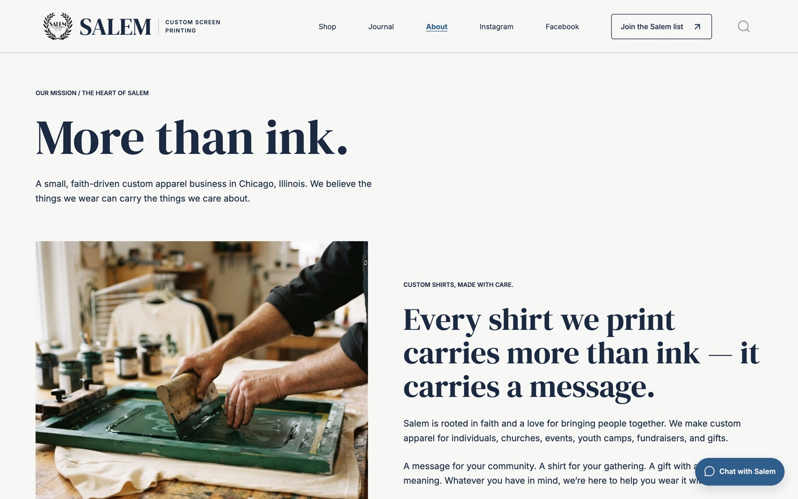
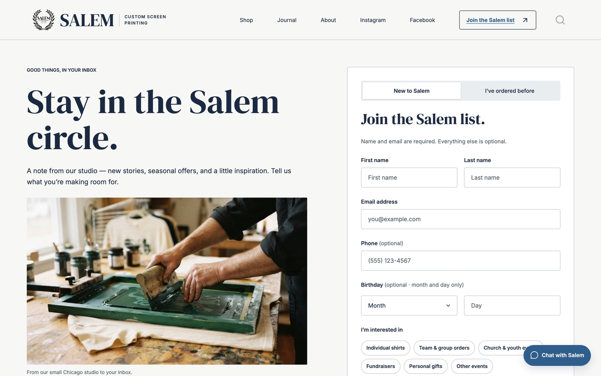

# Salem Custom Screen Printing — Website & Journal

The website and journal for **Salem Custom Screen Printing**, a small, faith-driven custom apparel studio in Chicago serving individuals, churches, events, and youth camps.

### Live site: https://iquinones2.github.io/Salem-Blog/ · En español: https://iquinones2.github.io/Salem-Blog/es/

[](https://github.com/iquinones2/Salem-Blog/actions/workflows/accessibility.yml)

<p align="center">
    
    
</p>
<p align="center">
    
    
</p>

The site is informational: it shares Salem's story, showcases past work, lets visitors design a shirt and request a quote, and runs the Salem list (newsletter). There is no checkout. To order, visitors message Salem on Instagram ("Chat with Salem" on every page), and quotes and payment are handled directly with Salem.

Every page comes in **English and Spanish**, in **light and dark mode**, and is checked automatically for **WCAG 2 AA** accessibility on each push.

This is also an ongoing personal development project, refined over time. For more projects, see my [personal portfolio](https://iquinones2.github.io/R-Data-Science-Portfolio/).

## Pages

| Page | What it does |
|---|---|
| **Home / Journal** (`index.qmd`) | Editorial homepage with the post listing, category filter, and a custom sort dropdown (newest, oldest, A–Z, Z–A) |
| **Shop** (`shop.qmd`) | Shirt customizer — pick a style (crew tee, V-neck, long sleeve), ink color, and font, add text or an uploaded image on the front or back, download a preview, and send a quote request. Nothing is charged. |
| **About** (`about.qmd`) | Salem's story and mission |
| **Join the Salem list** (`subscribe.qmd`) | Newsletter signup with client-side validation; saves to a Google Sheet and sends a welcome email |
| **Subscribed / Preferences / Unsubscribe** (`subscribed.qmd`, `preferences.qmd`, `unsubscribe.qmd`) | Confirmation page, interest editing via a private email link, and leaving the list (by email link or by name + email). Unsubscribing deletes the subscriber's row. |
| **Journal posts** (`posts/`) | Event write-ups and seasonal offers: Salem's Mission, Rooted, October Sale, Christmas Bundle |
| **Spanish site** (`es/`) | A Spanish copy of every page and post at the same paths, with its own journal and RSS feed (`es/index.xml`) |

## Features

- **Light and dark mode.** The site follows the visitor's device setting by default, with no flash of the wrong theme. Dark mode uses Salem's navy (`#041E42`) with white text and silver buttons.
- **English and Spanish.** Neutral Latin American Spanish (*usted*). An "Español" / "English" link in the header goes to the same page in the other language, and `hreflang` links tell search engines the pages are twins. People who sign up on a Spanish page get Spanish emails.
- **Settings panel.** The gear button in the header lets visitors choose Light, Dark or Auto, switch language, and turn on larger text (every font size 15% bigger). It's saved in the browser and works fully with a keyboard.
- **Accessibility.** Labeled form fields, status and error announcements for screen readers, alt text in both languages, and layouts tested down to 390px phone width. A GitHub Action checks the home and subscribe pages in both languages and both themes on every push.
- **Salem list automations.** The Apps Script backend also drafts a newsletter when a new journal post goes up, flags bounced emails, reminds Salem of upcoming order deadlines, and emails a monthly report. Every job drafts or reports only; nothing goes to customers without Salem's approval.

## Built with

- **[Quarto](https://quarto.org)** — static site generator for the pages and journal
- **CSS** — custom editorial design in `styles.css`, layered on the `lux` theme with light and dark SCSS themes (`assets/scss/`); fonts are DM Serif Display, Inter, Bebas Neue, and Caveat
- **Vanilla JavaScript** — the shirt customizer (`shop/`), journal sorting and filtering, form validation, the settings panel, and the Salem list client (`assets/js/`); all user-facing text in English/Spanish dictionaries; no frameworks or build step
- **Lua filter** — `assets/lua/i18n.lua` pairs each page with its other-language twin
- **Google Apps Script + Google Sheets** — the Salem list backend (`apps-script/Code.gs`): stores subscribers, sends English or Spanish emails, newsletters, and the scheduled automations
- **GitHub Actions + pa11y-ci** — the WCAG 2 AA accessibility check (`.github/workflows/accessibility.yml`)
- **GitHub Pages** — hosting, served from the `docs/` folder on `master`

## Project structure

```
_quarto.yml            Site config: navbar, light/dark themes, output to docs/
styles.css             All custom styles (color tokens for both themes at the top)
index.qmd              Homepage + journal listing (uses journal.ejs)
journal.ejs            Custom template for journal cards
about.qmd, shop.qmd, subscribe.qmd
subscribed.qmd, preferences.qmd, unsubscribe.qmd   Salem list pages
shop/                  customizer.js, shirt-styles.js
es/                    Spanish pages and posts (same file names as the English ones)
assets/js/             config.js (API URL), subscriber-store.js (Salem list client), one *-page.js per page
assets/scss/           Light and dark Bootstrap themes
assets/lua/i18n.lua    Language pairing (hreflang links, the header language link)
apps-script/           Code.gs: Salem list backend (pasted into Apps Script; not published)
posts/                 One folder per post (index.qmd, thumbnail, photos/)
posts/_metadata.yml    Shared post layout (partials, date format, freeze)
_partials/             Post title block and footer (English, and Spanish in _partials/es/),
                       plus site-settings.html (the header language link and settings panel)
images/                Logo, page photos, shirt mockups, icons, README screenshots
.github/               Accessibility workflow and pa11y settings (light.json, dark.json)
docs/                  Rendered site (generated — do not edit by hand)
SITE-GUIDE.md          How themes, languages and the accessibility check work
TRANSLATION-REVIEW.md  Checklist for a Spanish reviewer
```

## Working on the site

Requires [Quarto](https://quarto.org/docs/get-started/) 1.10 or newer (the light/dark theme setup uses recent Quarto features).

```bash
quarto preview    # live-reloading local preview
quarto render     # build the site into docs/
```

Edit the `.qmd`, `styles.css`, `_partials/`, or `shop/` source files — never `docs/` directly. After rendering, commit the source changes and `docs/` together and push to `master`; GitHub Pages republishes automatically.

### Adding a journal post

1. Create `posts/<Post-Name>/index.qmd` with `title`, `author`, `date` (`YYYY-MM-DD`), `image` (thumbnail), `description`, and `categories`.
2. Put the thumbnail and a `photos/` folder in the same post folder, and give every image `fig-alt` text.
3. Copy it to `es/posts/<Post-Name>/index.qmd` (same folder name) and translate it. Point its images at the English post's files instead of copying them.
4. Run `quarto render`, check both versions locally in light and dark mode, then commit and push.

More detail, including how to change colors and read the accessibility results, is in [`SITE-GUIDE.md`](SITE-GUIDE.md).

## Roadmap

- Connect the shop quote request form to a delivery service (it currently validates and confirms on the page only)
- A fluent Spanish speaker's review of the translations ([`TRANSLATION-REVIEW.md`](TRANSLATION-REVIEW.md))
- An order page with payment, once Salem is ready for it

## Attribution

This project began from a Quarto course-blog template (see `quartoCourseBlog.Rproj` and the original readme in git history). Refer to the [Quarto documentation](https://quarto.org) for more on Quarto websites. Preserve any license or attribution notices from the original template when redistributing.
