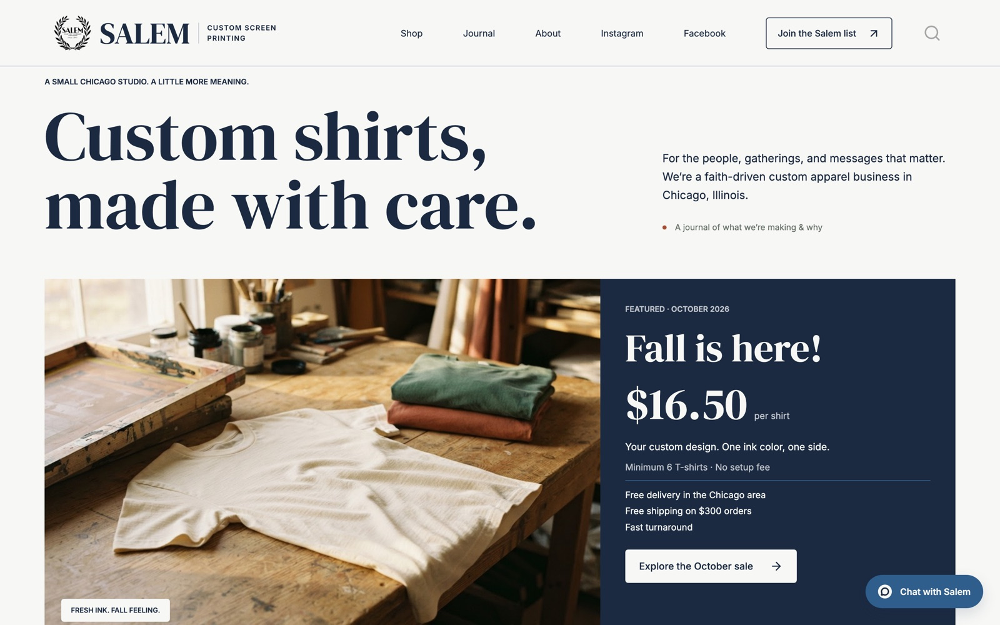
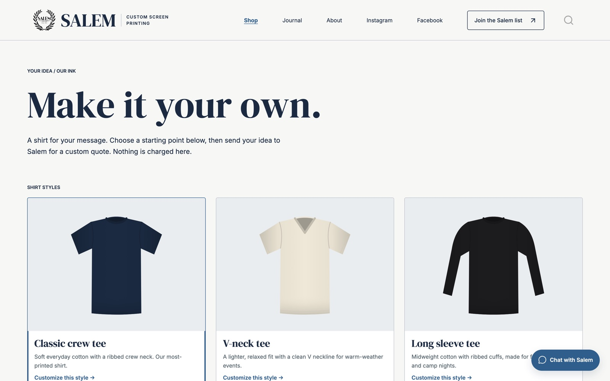
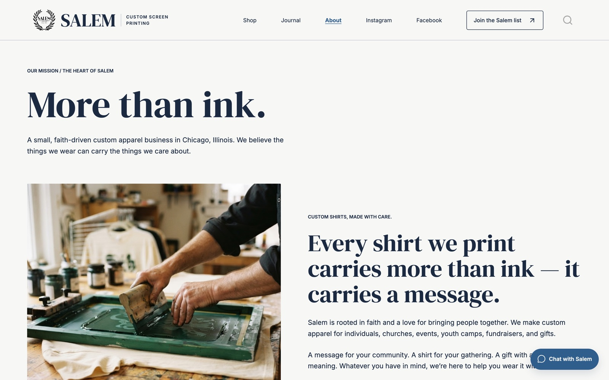
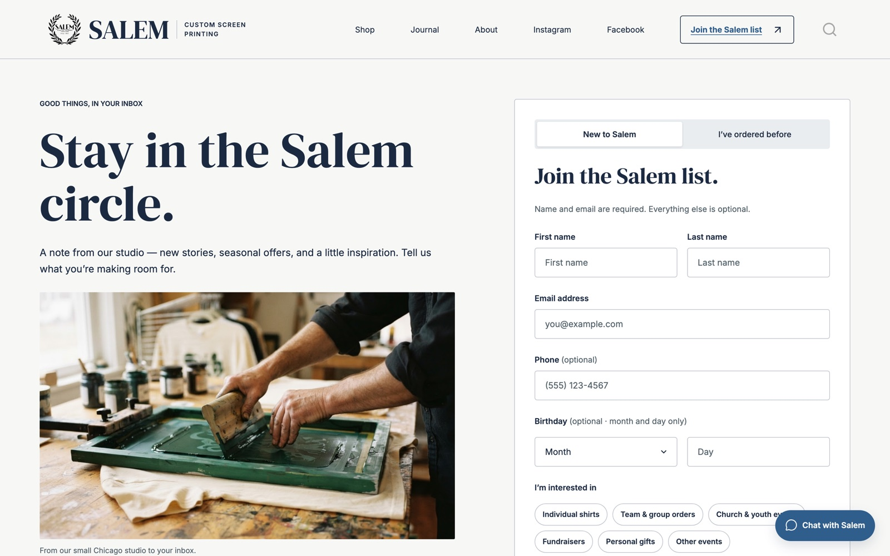

# Salem Custom Screen Printing — Website & Journal

The website and journal for **Salem Custom Screen Printing**, a small, faith-driven custom apparel studio in Chicago serving individuals, churches, events, and youth camps.

### Live site: https://iquinones2.github.io/Salem-Blog/

<p align="center">
    
    
</p>
<p align="center">
    
    
</p>

The site is informational: it shares Salem's story, showcases past work, lets visitors design a shirt and request a quote, and runs the Salem list (newsletter). There is no checkout. To order, visitors message Salem on Instagram ("Chat with Salem" on every page), and quotes and payment are handled directly with Salem.

This is also an ongoing personal development project, refined over time. For more projects, see my [personal portfolio](https://iquinones2.github.io/R-Data-Science-Portfolio/).

## Pages

| Page | What it does |
|---|---|
| **Home / Journal** (`index.qmd`) | Editorial homepage with the post listing, category filter, and a custom sort dropdown (newest, oldest, A–Z, Z–A) |
| **Shop** (`shop.qmd`) | Shirt customizer — pick a style (crew tee, V-neck, long sleeve), ink color, and font, add text or an uploaded image on the front or back, download a preview, and send a quote request. Nothing is charged. |
| **About** (`about.qmd`) | Salem's story and mission |
| **Join the Salem list** (`subscribe.qmd`) | Newsletter signup with client-side validation; saves to a Google Sheet and sends a welcome email |
| **Subscribed / Preferences / Unsubscribe** (`subscribed.qmd`, `preferences.qmd`, `unsubscribe.qmd`) | Confirmation page, interest editing via a private email link, and leaving the list (by email link or by name + email). Unsubscribing deletes the subscriber's row. |
| **Journal posts** (`posts/`) | Event write-ups and seasonal offers: Salem's Mission, Rooted, October Sale, Christmas Bundle |

## Built with

- **[Quarto](https://quarto.org)** — static site generator for the pages and journal
- **CSS** — custom editorial design in `styles.css`, layered on the `lux` theme; fonts are DM Serif Display, Inter, Bebas Neue, and Caveat
- **Vanilla JavaScript** — the shirt customizer (`shop/`), journal sorting and filtering, form validation, and the Salem list client (`assets/js/`); no frameworks or build step
- **Google Apps Script + Google Sheets** — the Salem list backend (`apps-script/Code.gs`): stores subscribers and sends welcome/link emails
- **GitHub Pages** — hosting, served from the `docs/` folder on `master`

## Project structure

```
_quarto.yml            Site config: navbar, theme, output to docs/
styles.css             All custom styles
index.qmd              Homepage + journal listing (uses journal.ejs)
journal.ejs            Custom template for journal cards
about.qmd, shop.qmd, subscribe.qmd
subscribed.qmd, preferences.qmd, unsubscribe.qmd   Salem list pages
shop/                  customizer.js, shirt-styles.js
assets/js/             config.js (API URL), subscriber-store.js (Salem list client)
apps-script/           Code.gs: Salem list backend (pasted into Apps Script; not published)
posts/                 One folder per post (index.qmd, thumbnail, photos/)
posts/_metadata.yml    Shared post layout (partials, date format, freeze)
_partials/             Shared post title block and footer (with newsletter signup)
images/                Logo, page photos, shirt mockups, icons, README screenshots
docs/                  Rendered site (generated — do not edit by hand)
```

## Working on the site

Requires [Quarto](https://quarto.org/docs/get-started/) 1.4 or newer.

```bash
quarto preview    # live-reloading local preview
quarto render     # build the site into docs/
```

Edit the `.qmd`, `styles.css`, `_partials/`, or `shop/` source files — never `docs/` directly. After rendering, commit the source changes and `docs/` together and push to `master`; GitHub Pages republishes automatically.

### Adding a journal post

1. Create `posts/<Post-Name>/index.qmd` with `title`, `author`, `date` (`YYYY-MM-DD`), `image` (thumbnail), `description`, and `categories`.
2. Put the thumbnail and a `photos/` folder in the same post folder, and give every image `fig-alt` text.
3. Run `quarto render`, check the post locally, then commit and push.

## Roadmap

- Connect the shop quote request form to a delivery service (it currently validates and confirms on the page only)
- Email new journal posts to the Salem list
- An order page with payment, once Salem is ready for it

## Attribution

This project began from a Quarto course-blog template (see `quartoCourseBlog.Rproj` and the original readme in git history). Refer to the [Quarto documentation](https://quarto.org) for more on Quarto websites. Preserve any license or attribution notices from the original template when redistributing.
