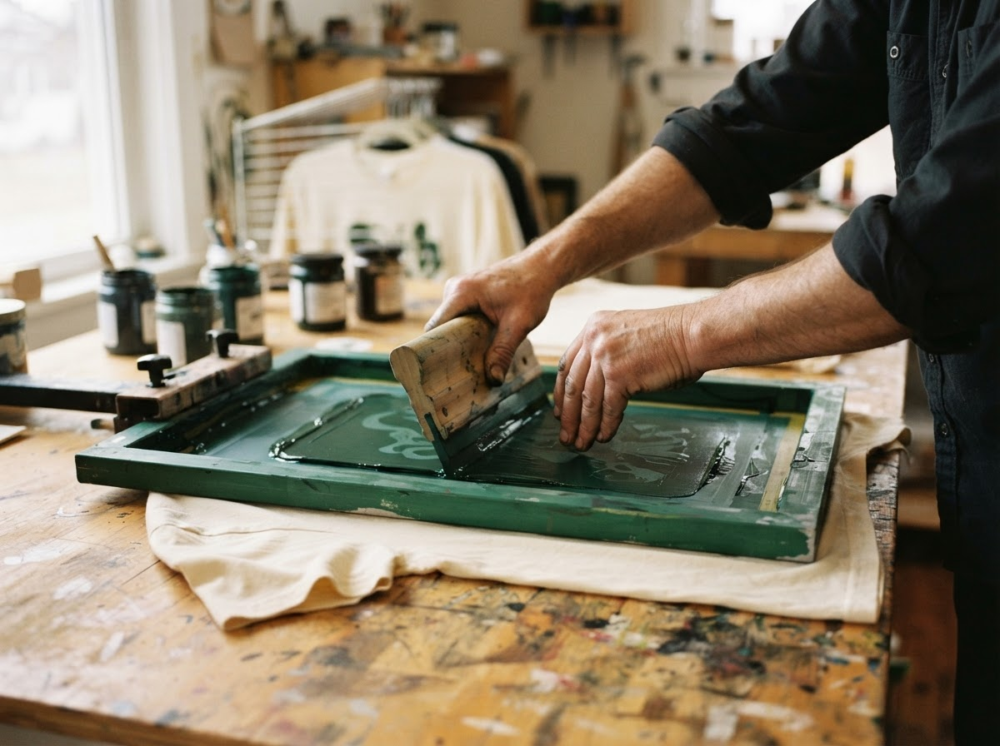

```{=html}
<section class="newsletter-page">
  <div class="newsletter-story">
    <p class="section-label">Good things, in your inbox</p>
    <h1 class="about-heading">Stay in the Salem circle.</h1>
    <p class="about-lede">A note from our studio — new stories, seasonal offers, and a little inspiration. Tell us what you’re making room for.</p>
    <figure class="about-photo">
      
      <figcaption>From our small Chicago studio to your inbox.</figcaption>
    </figure>
    <h2 class="story-subheading">A little ink. A lot of heart.</h2>
    <p class="story-copy">Choose your interests so we know what matters to you. Unsubscribe from post emails whenever you like.</p>
    <ul class="list-perks">
      <li><strong>New to Salem?</strong> Seasonal offers, studio stories, and a first look at new designs.</li>
      <li><strong>Printed with us before?</strong> Early notice when custom order spots open, plus easy reorders for your group.</li>
    </ul>
  </div>

  <div class="signup-card">
    <div class="signup-form-view" id="signup-form-view">
      <div class="audience-toggle" role="radiogroup" aria-label="Which describes you?">
        <label><input type="radio" name="audience" value="new" checked> New to Salem</label>
        <label><input type="radio" name="audience" value="returning"> I’ve ordered before</label>
      </div>

      <h2 class="signup-heading" id="signup-heading">Join the Salem list.</h2>
      <p class="signup-intro" id="signup-intro">Name and email are required. Everything else is optional.</p>

      <div class="list-notice" id="list-notice" role="status" tabindex="-1" data-tone="none">
        <p class="list-notice-title" id="list-notice-title"></p>
        <p class="list-notice-copy" id="list-notice-copy"></p>
        <div class="list-notice-actions" id="list-notice-actions" hidden>
          <button type="button" class="btn-outline" id="resend-link">Email me my preferences link</button>
          <a class="list-text-link" href="index.html#journal">Read the latest studio stories ↗</a>
        </div>
      </div>

      <form id="sub-form" class="signup-form" novalidate>
        <!-- Spam trap: people never see or fill this; bots often do. -->
        <div class="list-honeypot" aria-hidden="true">
          <label for="website">Website</label>
          <input type="text" id="website" name="website" tabindex="-1" autocomplete="off">
        </div>
        <div class="field-pair">
          <div class="form-field">
            <label for="first">First name</label>
            <input class="field-input" type="text" id="first" name="first" autocomplete="given-name" placeholder="First name" required>
          </div>
          <div class="form-field">
            <label for="last">Last name</label>
            <input class="field-input" type="text" id="last" name="last" autocomplete="family-name" placeholder="Last name" required>
          </div>
        </div>

        <div class="form-field">
          <label for="email">Email address</label>
          <input class="field-input" type="email" id="email" name="email" autocomplete="email" placeholder="you@example.com" required>
        </div>

        <div class="form-field">
          <label for="phone">Phone <span class="field-optional">(optional)</span></label>
          <input class="field-input" type="tel" id="phone" name="phone" autocomplete="tel" placeholder="(555) 123-4567">
        </div>

        <fieldset class="form-field">
          <legend>Birthday <span class="field-optional">(optional · month and day only)</span></legend>
          <div class="field-pair">
            <select class="field-input" id="bmonth" name="bmonth" aria-label="Birthday month">
              <option value="">Month</option>
              <option value="January">January</option><option value="February">February</option><option value="March">March</option>
              <option value="April">April</option><option value="May">May</option><option value="June">June</option>
              <option value="July">July</option><option value="August">August</option><option value="September">September</option>
              <option value="October">October</option><option value="November">November</option><option value="December">December</option>
            </select>
            <input class="field-input" type="number" id="bday" name="bday" min="1" max="31" inputmode="numeric" placeholder="Day" aria-label="Birthday day">
          </div>
        </fieldset>

        <fieldset class="form-field">
          <legend>I’m interested in</legend>
          <div class="interest-chips">
            <label><input type="checkbox" name="interest" value="Individual shirts"><span>Individual shirts</span></label>
            <label><input type="checkbox" name="interest" value="Team and group orders"><span>Team &amp; group orders</span></label>
            <label><input type="checkbox" name="interest" value="Church and youth events"><span>Church &amp; youth events</span></label>
            <label><input type="checkbox" name="interest" value="Fundraisers"><span>Fundraisers</span></label>
            <label><input type="checkbox" name="interest" value="Personal gifts"><span>Personal gifts</span></label>
            <label><input type="checkbox" name="interest" value="Other events"><span>Other events</span></label>
          </div>
        </fieldset>

        <div class="form-field" data-audience="new">
          <label for="source">How did you hear about Salem? <span class="field-optional">(optional)</span></label>
          <select class="field-input" id="source" name="source">
            <option value="">Choose one</option>
            <option>Friend or family</option>
            <option>Church or event</option>
            <option>Instagram</option>
            <option>Facebook</option>
            <option>LinkedIn</option>
            <option>Other</option>
          </select>
        </div>

        <div class="form-field" data-audience="returning" hidden>
          <label for="past-order">What have you printed with us? <span class="field-optional">(optional)</span></label>
          <input class="field-input" type="text" id="past-order" name="past_order" placeholder="e.g., Fall camp tees, 2025">
          <p class="field-hint">Helps us line up your next order with the same design and sizes.</p>
        </div>

        <label class="consent-check" for="consent">
          <input type="checkbox" id="consent" name="consent" required>
          <span>I agree to receive emails from Salem Custom Screen Printing and understand I can unsubscribe at any time.</span>
        </label>

        <button type="submit" class="btn-accent signup-submit">
          <span id="signup-submit-label">Join the Salem list</span>
          
        </button>
        <p class="field-hint">Just Salem news. <a class="list-text-link" href="unsubscribe.html">Unsubscribe anytime</a>. Your phone number and birthday are optional.</p>
        <p class="form-error" id="form-error" role="alert"></p>
      </form>
    </div>

  </div>
</section>

<section class="salem-circle">
  <div class="footer-nav">
    <div class="brand-signoff">
      <div class="salem-brand">
        <span class="wordmark">SALEM</span>
        <span class="brand-descriptor">CUSTOM SCREEN<br>PRINTING</span>
      </div>
      <p>Chicago, Illinois<br>Custom shirts, made with care.</p>
    </div>
    <div class="footer-links">
      <div>
        <p class="section-label">Explore</p>
        <a href="shop.html">Shop</a>
        <a href="index.html#journal">The journal</a>
        <a href="about.html">About Salem</a>
        <a href="subscribe.html">Join the Salem list</a>
      </div>
      <div>
        <p class="section-label">Follow along</p>
        <a href="https://www.instagram.com/salem.csp5/" target="_blank" rel="noopener">Instagram ↗</a>
        <a href="https://www.facebook.com/profile.php?id=61590308556408" target="_blank" rel="noopener">Facebook ↗</a>
      </div>
    </div>
  </div>
  <hr class="section-rule">
  <div class="footer-small-print">
    <span>© 2026 Salem Custom Screen Printing</span>
    <span>Made with care. Worn with purpose.</span>
  </div>
</section>

<a class="chat-button" href="https://ig.me/m/salem.csp5" target="_blank" rel="noopener">
  
  Chat with Salem
</a>

<script src="assets/js/config.js?v=2026-11-16b"></script>
<script src="assets/js/subscriber-store.js?v=2026-11-16b"></script>
<script src="assets/js/subscribe-page.js?v=2026-11-16b"></script>
```
