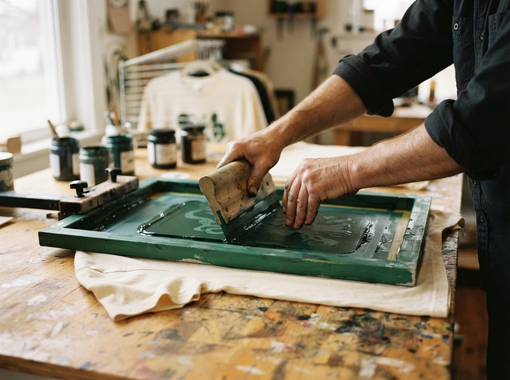

```{=html}
<section class="newsletter-page">
  <div class="newsletter-story">
    <p class="section-label">Good things, in your inbox</p>
    <h1 class="about-heading">Stay in the Salem circle.</h1>
    <p class="about-lede">A note from our studio — new stories, seasonal offers, and a little inspiration. Tell us what you’re making room for.</p>
    <figure class="about-photo">
      
      <figcaption>From our small Chicago studio to your inbox.</figcaption>
    </figure>
    <h2 class="story-subheading">A little ink. A lot of heart.</h2>
    <p class="story-copy">Choose your interests so we know what matters to you. Unsubscribe from post emails whenever you like.</p>
    <ul class="list-perks">
      <li><strong>New to Salem?</strong> Seasonal offers, studio stories, and a first look at new designs.</li>
      <li><strong>Printed with us before?</strong> Early notice when custom order spots open, plus easy reorders for your group.</li>
    </ul>
  </div>

  <div class="signup-card">
    <div class="signup-form-view" id="signup-form-view">
      <div class="audience-toggle" role="radiogroup" aria-label="Which describes you?">
        <label><input type="radio" name="audience" value="new" checked> New to Salem</label>
        <label><input type="radio" name="audience" value="returning"> I’ve ordered before</label>
      </div>

      <h2 class="signup-heading" id="signup-heading">Join the Salem list.</h2>
      <p class="signup-intro" id="signup-intro">Name and email are required. Everything else is optional.</p>

      <form id="sub-form" class="signup-form" novalidate>
        <div class="field-pair">
          <div class="form-field">
            <label for="first">First name</label>
            <input class="field-input" type="text" id="first" name="first" autocomplete="given-name" placeholder="First name" required>
          </div>
          <div class="form-field">
            <label for="last">Last name</label>
            <input class="field-input" type="text" id="last" name="last" autocomplete="family-name" placeholder="Last name" required>
          </div>
        </div>

        <div class="form-field">
          <label for="email">Email address</label>
          <input class="field-input" type="email" id="email" name="email" autocomplete="email" placeholder="you@example.com" required>
        </div>

        <div class="form-field">
          <label for="phone">Phone <span class="field-optional">(optional)</span></label>
          <input class="field-input" type="tel" id="phone" name="phone" autocomplete="tel" placeholder="(555) 123-4567">
        </div>

        <fieldset class="form-field">
          <legend>Birthday <span class="field-optional">(optional · month and day only)</span></legend>
          <div class="field-pair">
            <select class="field-input" id="bmonth" name="bmonth" aria-label="Birthday month">
              <option value="">Month</option>
              <option>January</option><option>February</option><option>March</option>
              <option>April</option><option>May</option><option>June</option>
              <option>July</option><option>August</option><option>September</option>
              <option>October</option><option>November</option><option>December</option>
            </select>
            <input class="field-input" type="number" id="bday" name="bday" min="1" max="31" inputmode="numeric" placeholder="Day" aria-label="Birthday day">
          </div>
        </fieldset>

        <fieldset class="form-field">
          <legend>I’m interested in</legend>
          <div class="interest-chips">
            <label><input type="checkbox" name="interest" value="Individual shirts"><span>Individual shirts</span></label>
            <label><input type="checkbox" name="interest" value="Team and group orders"><span>Team &amp; group orders</span></label>
            <label><input type="checkbox" name="interest" value="Church and youth events"><span>Church &amp; youth events</span></label>
            <label><input type="checkbox" name="interest" value="Fundraisers"><span>Fundraisers</span></label>
            <label><input type="checkbox" name="interest" value="Personal gifts"><span>Personal gifts</span></label>
            <label><input type="checkbox" name="interest" value="Other events"><span>Other events</span></label>
          </div>
        </fieldset>

        <div class="form-field" data-audience="new">
          <label for="source">How did you hear about Salem? <span class="field-optional">(optional)</span></label>
          <select class="field-input" id="source" name="source">
            <option value="">Choose one</option>
            <option>Friend or family</option>
            <option>Church or event</option>
            <option>Instagram</option>
            <option>Facebook</option>
            <option>LinkedIn</option>
            <option>Other</option>
          </select>
        </div>

        <div class="form-field" data-audience="returning" hidden>
          <label for="past-order">What have you printed with us? <span class="field-optional">(optional)</span></label>
          <input class="field-input" type="text" id="past-order" name="past_order" placeholder="e.g., Fall camp tees, 2025">
          <p class="field-hint">Helps us line up your next order with the same design and sizes.</p>
        </div>

        <label class="consent-check" for="consent">
          <input type="checkbox" id="consent" name="consent" required>
          <span>I agree to receive emails from Salem Custom Screen Printing and understand I can unsubscribe at any time.</span>
        </label>

        <button type="submit" class="btn-accent signup-submit">
          <span id="signup-submit-label">Join the Salem list</span>
          
        </button>
        <p class="field-hint">Just Salem news. Unsubscribe anytime. Your phone number and birthday are optional.</p>
        <p class="form-error" id="form-error" role="alert"></p>
      </form>
    </div>

    <div class="signup-success" id="signup-success" tabindex="-1" hidden>
      <p class="section-label">You’re in the circle</p>
      <h2 class="signup-heading" id="success-heading">Welcome to Salem.</h2>
      <p class="signup-intro" id="success-copy">Watch your inbox for a note from our studio.</p>
      <div class="success-actions">
        <a class="btn-accent" href="shop.html">
          Design a shirt
          
        </a>
        <a class="btn-outline" href="index.html#journal">
          Read the journal
          
        </a>
      </div>
    </div>
  </div>
</section>

<section class="salem-circle">
  <div class="footer-nav">
    <div class="brand-signoff">
      <div class="salem-brand">
        <span class="wordmark">SALEM</span>
        <span class="brand-descriptor">CUSTOM SCREEN<br>PRINTING</span>
      </div>
      <p>Chicago, Illinois<br>Custom shirts, made with care.</p>
    </div>
    <div class="footer-links">
      <div>
        <p class="section-label">Explore</p>
        <a href="shop.html">Shop</a>
        <a href="index.html#journal">The journal</a>
        <a href="about.html">About Salem</a>
        <a href="subscribe.html">Join the Salem list</a>
      </div>
      <div>
        <p class="section-label">Follow along</p>
        <a href="https://www.instagram.com/salem.csp5/" target="_blank" rel="noopener">Instagram ↗</a>
        <a href="https://www.facebook.com/profile.php?id=61590308556408" target="_blank" rel="noopener">Facebook ↗</a>
      </div>
    </div>
  </div>
  <hr class="section-rule">
  <div class="footer-small-print">
    <span>© 2026 Salem Custom Screen Printing</span>
    <span>Made with care. Worn with purpose.</span>
  </div>
</section>

<a class="chat-button" href="https://ig.me/m/salem.csp5" target="_blank" rel="noopener">
  
  Chat with Salem
</a>

<script>
document.addEventListener("DOMContentLoaded", function () {
  const form = document.getElementById("sub-form");
  const monthInput = document.getElementById("bmonth");
  const dayInput = document.getElementById("bday");
  const errorBox = document.getElementById("form-error");
  const submitButton = form.querySelector(".signup-submit");

  // Google Form that collects signups (responses land in its linked Google Sheet).
  // To connect it: in the Google Form, use ⋮ → "Get pre-filled link", fill every
  // question, copy the link, then paste the form ID (the long part after /d/e/)
  // and each "entry.123..." number below. Make every question "Short answer".
  // While formId is empty, nothing is sent and the form only shows its confirmation.
  const GOOGLE_FORM = {
    formId: "",            // e.g. "1FAIpQLSc...xyz"
    entries: {
      audience: "",        // "New to Salem" or "Ordered before"
      first: "",
      last: "",
      email: "",
      phone: "",
      birthday: "",        // e.g. "March 14"
      interests: "",       // comma-separated
      source: "",          // how they heard about Salem (new subscribers)
      pastOrder: ""        // what they printed before (returning customers)
    }
  };

  // Copy that changes with "New to Salem" / "I've ordered before"
  const audienceCopy = {
    new: {
      heading: "Join the Salem list.",
      intro: "Name and email are required. Everything else is optional.",
      submit: "Join the Salem list",
      successHeading: "Welcome to Salem.",
      successCopy: "Watch your inbox for a note from our studio, with seasonal offers and the stories behind what we print."
    },
    returning: {
      heading: "Welcome back.",
      intro: "Thanks for printing with us. Stay close for reorder openings, seasonal offers, and new designs.",
      submit: "Keep me in the loop",
      successHeading: "Good to see you again.",
      successCopy: "We’ll let you know when custom order spots open, so your next round of shirts is easy."
    }
  };

  function currentAudience() {
    return form.closest(".signup-card").querySelector('input[name="audience"]:checked').value;
  }

  function applyAudience() {
    const audience = currentAudience();
    const copy = audienceCopy[audience];
    document.getElementById("signup-heading").textContent = copy.heading;
    document.getElementById("signup-intro").textContent = copy.intro;
    document.getElementById("signup-submit-label").textContent = copy.submit;
    form.querySelectorAll("[data-audience]").forEach(function (field) {
      field.hidden = field.dataset.audience !== audience;
    });
  }

  document.querySelectorAll('input[name="audience"]').forEach(function (radio) {
    radio.addEventListener("change", applyAudience);
  });

  // Prefill email when arriving from the homepage signup
  const emailParam = new URLSearchParams(window.location.search).get("email");
  if (emailParam) document.getElementById("email").value = emailParam;

  function validateBirthday() {
    const month = monthInput.value;
    const day = dayInput.value;
    monthInput.setCustomValidity("");
    dayInput.setCustomValidity("");

    // Birthday is optional if both fields are empty.
    if (month === "" && day === "") return true;

    // If one field is filled, require the other.
    if (month === "") {
      monthInput.setCustomValidity("Please select a birthday month.");
      return false;
    }
    if (day === "") {
      dayInput.setCustomValidity("Please enter a birthday day.");
      return false;
    }

    // Use a non-leap year, so February has 28 days.
    const daysInMonth = new Date(2001, monthInput.selectedIndex, 0).getDate();
    const dayNumber = Number(day);
    if (!Number.isInteger(dayNumber) || dayNumber < 1 || dayNumber > daysInMonth) {
      dayInput.setCustomValidity(month + " has only " + daysInMonth + " days. Please enter a valid day.");
      return false;
    }
    return true;
  }

  monthInput.addEventListener("change", validateBirthday);
  dayInput.addEventListener("input", validateBirthday);

  form.addEventListener("submit", function (event) {
    event.preventDefault();
    validateBirthday();
    if (!form.checkValidity()) {
      const firstInvalid = form.querySelector("input:invalid, select:invalid");
      const label = firstInvalid.labels && firstInvalid.labels.length
        ? firstInvalid.labels[0].textContent.replace("(optional)", "").trim()
        : firstInvalid.getAttribute("aria-label");
      errorBox.textContent = firstInvalid.id === "consent"
        ? "Please agree to receive emails so we can add you to the list."
        : label + ": " + firstInvalid.validationMessage;
      form.classList.add("was-submitted");
      firstInvalid.focus();
      return;
    }
    errorBox.textContent = "";

    submitButton.disabled = true;
    form.setAttribute("aria-busy", "true");
    sendSignup()
      .then(showSuccess)
      .catch(function () {
        errorBox.textContent = "We couldn’t reach the signup service. Please check your connection and try again, or message Salem on Instagram.";
      })
      .finally(function () {
        submitButton.disabled = false;
        form.removeAttribute("aria-busy");
      });
  });

  function sendSignup() {
    if (!GOOGLE_FORM.formId) return Promise.resolve();

    const audience = currentAudience();
    const values = {
      audience: audience === "returning" ? "Ordered before" : "New to Salem",
      first: document.getElementById("first").value.trim(),
      last: document.getElementById("last").value.trim(),
      email: document.getElementById("email").value.trim(),
      phone: document.getElementById("phone").value.trim(),
      birthday: monthInput.value && dayInput.value ? monthInput.value + " " + Number(dayInput.value) : "",
      interests: Array.from(form.querySelectorAll('input[name="interest"]:checked'))
        .map(function (box) { return box.value; }).join(", "),
      source: audience === "new" ? document.getElementById("source").value : "",
      pastOrder: audience === "returning" ? document.getElementById("past-order").value.trim() : ""
    };

    const body = new URLSearchParams();
    Object.keys(GOOGLE_FORM.entries).forEach(function (key) {
      const entryId = GOOGLE_FORM.entries[key];
      if (entryId && values[key]) body.append(entryId, values[key]);
    });

    // Google Forms doesn't allow cross-site reads, so the response is opaque:
    // a resolved fetch means the request went out; a rejected one means it didn't.
    return fetch("https://docs.google.com/forms/d/e/" + GOOGLE_FORM.formId + "/formResponse", {
      method: "POST",
      mode: "no-cors",
      body: body
    });
  }

  function showSuccess() {
    const copy = audienceCopy[currentAudience()];
    const firstName = document.getElementById("first").value.trim();
    document.getElementById("success-heading").textContent = copy.successHeading.replace(".", firstName ? ", " + firstName + "." : ".");
    document.getElementById("success-copy").textContent = copy.successCopy;
    document.getElementById("signup-form-view").hidden = true;
    const success = document.getElementById("signup-success");
    success.hidden = false;
    success.focus();
  }

  applyAudience();
});
</script>
```