```{=html}
<section class="list-status-page">
  <!-- Step 1: confirm. Never unsubscribe on page load (email scanners open links). -->
  <div class="list-status" data-view="confirm">
    <p class="section-label">Leave the Salem list</p>
    <h1 class="list-status-heading" tabindex="-1">Unsubscribe from Salem emails?</h1>
    <p class="list-status-lede">You’ll stop getting Salem’s post emails, studio stories, and seasonal offers, and your details will be removed from our list.</p>
    <p class="list-status-copy">Rather hear about fewer things? You can change your interests instead.</p>
    <div class="list-status-actions list-status-actions--stacked">
      <button type="button" class="btn-accent" id="unsubscribe-button">
        <span id="unsubscribe-label">Unsubscribe me</span>
        
      </button>
      <a class="btn-outline" href="preferences.html">
        Update my interests instead
        
      </a>
    </div>
    <p class="list-form-status" id="unsubscribe-status" role="status"></p>
  </div>

  <!-- Step 2: done (Figma "You're off the list.") -->
  <div class="list-status" data-view="done" hidden>
    <span class="list-status-icon" aria-hidden="true">
      <svg viewBox="0 0 24 24" width="24" height="24"><path d="M5 12.5l4.5 4.5L19 7.5" fill="none" stroke="currentColor" stroke-width="2" stroke-linecap="round" stroke-linejoin="round"/></svg>
    </span>
    <p class="section-label">Unsubscribe confirmed</p>
    <h1 class="list-status-heading" tabindex="-1">You’re off the list.</h1>
    <p class="list-status-lede" id="done-lede">You’ve successfully unsubscribed from Salem’s post emails, and your details have been removed from our list. You won’t receive any further post emails from us.</p>
    <p class="list-status-copy">Thank you for spending a little time in the Salem circle. You can still visit the journal for studio stories and seasonal offers.</p>
    <div class="list-status-actions list-status-actions--stacked">
      <a class="btn-accent" href="subscribe.html">
        Resubscribe to the Salem list
        
      </a>
      <a class="btn-outline" href="index.html#journal">
        Back to the journal
        
      </a>
    </div>
    <p class="list-status-note">Changed your mind? Resubscribing is always your choice.</p>
  </div>

  <!-- Arrived without an email link: unsubscribe right here with name + email -->
  <div class="list-status" data-view="request" hidden>
    <p class="section-label">Leave the Salem list</p>
    <h1 class="list-status-heading" tabindex="-1">Unsubscribe from Salem emails.</h1>
    <p class="list-status-lede">Enter the name and email you signed up with. Your details will be removed from our list and you won’t get any more Salem emails.</p>
    <form class="list-resend" id="leave-form" novalidate>
      <div class="list-honeypot" aria-hidden="true">
        <label for="leave-website">Website</label>
        <input type="text" id="leave-website" tabindex="-1" autocomplete="off">
      </div>
      <div class="field-pair">
        <div class="form-field">
          <label for="leave-first">First name</label>
          <input class="field-input" type="text" id="leave-first" autocomplete="given-name" placeholder="First name" required>
        </div>
        <div class="form-field">
          <label for="leave-last">Last name</label>
          <input class="field-input" type="text" id="leave-last" autocomplete="family-name" placeholder="Last name" required>
        </div>
      </div>
      <div class="form-field">
        <label for="leave-email">Email address</label>
        <input class="field-input" type="email" id="leave-email" autocomplete="email" placeholder="you@example.com" required>
      </div>
      <button type="submit" class="btn-accent" id="leave-button">
        <span id="leave-label">Unsubscribe me</span>
        
      </button>
      <p class="list-form-status" id="leave-status" role="status"></p>
    </form>
    <p class="list-status-note">Changed your mind? <a class="list-text-link" href="subscribe.html">Stay on the Salem list</a>.</p>
  </div>

  <!-- No token, or a token that no longer matches anyone -->
  <div class="list-status" data-view="missing" hidden>
    <p class="section-label">Link not recognized</p>
    <h1 class="list-status-heading" tabindex="-1">We couldn’t find that link.</h1>
    <p class="list-status-lede">It may be incomplete, or it may be from before you last signed up. Each signup gets a fresh link.</p>
    <p class="list-status-copy">Enter your email and we’ll send you a new link to unsubscribe or update your interests.</p>
      <form class="list-resend" data-resend-form novalidate>
        <div class="form-field">
          <label for="resend-email">Email address</label>
          <input class="field-input" type="email" id="resend-email" autocomplete="email" placeholder="you@example.com" required aria-describedby="resend-status">
        </div>
        <button type="submit" class="btn-accent">
          Email me a fresh link
          
        </button>
        <p class="list-form-status" id="resend-status" role="status"></p>
      </form>
    <p class="list-status-note"><button type="button" class="list-text-link" id="use-leave-form">Unsubscribe with your name and email instead</button></p>
  </div>
</section>

<section class="salem-circle">
  <div class="footer-nav">
    <div class="brand-signoff">
      <div class="salem-brand">
        <span class="wordmark">SALEM</span>
        <span class="brand-descriptor">CUSTOM SCREEN<br>PRINTING</span>
      </div>
      <p>Chicago, Illinois<br>Custom shirts, made with care.</p>
    </div>
    <div class="footer-links">
      <div>
        <p class="section-label">Explore</p>
        <a href="shop.html">Shop</a>
        <a href="index.html#journal">The journal</a>
        <a href="about.html">About Salem</a>
        <a href="subscribe.html">Join the Salem list</a>
      </div>
      <div>
        <p class="section-label">Follow along</p>
        <a href="https://www.instagram.com/salem.csp5/" target="_blank" rel="noopener">Instagram ↗</a>
        <a href="https://www.facebook.com/profile.php?id=61590308556408" target="_blank" rel="noopener">Facebook ↗</a>
      </div>
    </div>
  </div>
  <hr class="section-rule">
  <div class="footer-small-print">
    <span>© 2026 Salem Custom Screen Printing</span>
    <span>Made with care. Worn with purpose.</span>
  </div>
</section>

<a class="chat-button" href="https://ig.me/m/salem.csp5" target="_blank" rel="noopener">
  
  Chat with Salem
</a>

<script src="assets/js/config.js?v=2026-11-09b"></script>
<script src="assets/js/subscriber-store.js?v=2026-11-09b"></script>
<script>
document.addEventListener("DOMContentLoaded", function () {
  const token = SalemList.takeToken(); // also removes ?token= from the address bar
  const button = document.getElementById("unsubscribe-button");
  const label = document.getElementById("unsubscribe-label");
  const status = document.getElementById("unsubscribe-status");
  let leaveFormBound = false; // declared before any bindLeaveForm() call

  function show(view, moveFocus) {
    document.querySelectorAll("[data-view]").forEach(function (el) {
      el.hidden = el.dataset.view !== view;
    });
    if (moveFocus) document.querySelector('[data-view="' + view + '"] .list-status-heading').focus();
  }

  document.querySelectorAll("[data-resend-form]").forEach(SalemList.bindResendForm);
  document.getElementById("use-leave-form").addEventListener("click", function () {
    show("request", true);
    bindLeaveForm();
  });

  if (!token) {
    show("request");
    bindLeaveForm();
    return;
  }

  /* ---------- Unsubscribe with name + email (no link needed) ---------- */
  function bindLeaveForm() {
    if (leaveFormBound) return;
    leaveFormBound = true;
    const form = document.getElementById("leave-form");
    const leaveButton = document.getElementById("leave-button");
    const leaveLabel = document.getElementById("leave-label");
    const leaveStatus = document.getElementById("leave-status");
    const inputs = {
      firstName: document.getElementById("leave-first"),
      lastName: document.getElementById("leave-last"),
      email: document.getElementById("leave-email")
    };

    function setError(input, message) {
      const id = input.id + "-error";
      let msg = document.getElementById(id);
      if (message) {
        if (!msg) {
          msg = document.createElement("p");
          msg.id = id;
          msg.className = "field-error";
          input.closest(".form-field").insertAdjacentElement("afterend", msg);
        }
        msg.textContent = message;
        input.setAttribute("aria-invalid", "true");
        input.setAttribute("aria-describedby", id);
      } else {
        if (msg) msg.remove();
        input.removeAttribute("aria-invalid");
        input.removeAttribute("aria-describedby");
      }
    }

    form.addEventListener("input", function (event) {
      if (event.target.getAttribute("aria-invalid") && event.target.checkValidity()) setError(event.target, "");
    });

    form.addEventListener("submit", function (event) {
      event.preventDefault();
      let firstBad = null;
      Object.keys(inputs).forEach(function (key) {
        const input = inputs[key];
        input.value = input.value.trim();
        const message = input.checkValidity() ? "" :
          key === "email" ? "Enter a complete email address, such as you@example.com." :
          "Enter your " + (key === "firstName" ? "first" : "last") + " name.";
        setError(input, message);
        if (message && !firstBad) firstBad = input;
      });
      if (firstBad) { firstBad.focus(); return; }

      leaveButton.disabled = true;
      leaveLabel.textContent = "Unsubscribing…";
      leaveStatus.setAttribute("role", "status");
      leaveStatus.dataset.tone = "info";
      leaveStatus.textContent = "Please wait.";

      SalemList.unsubscribeByEmail({
        firstName: inputs.firstName.value,
        lastName: inputs.lastName.value,
        email: inputs.email.value,
        website: document.getElementById("leave-website").value
      }).then(function (res) {
        leaveButton.disabled = false;
        leaveLabel.textContent = "Unsubscribe me";
        leaveStatus.textContent = "";

        if (res.ok) {
          document.getElementById("done-lede").textContent =
            "If those details match someone on the Salem list, they’ve been removed and you won’t receive any further emails from us. Still getting emails? Use the “Unsubscribe” link at the bottom of any Salem email.";
          show("done", true);
        } else if (res.error === "validation" && res.fields) {
          let first = null;
          Object.keys(res.fields).forEach(function (key) {
            if (!inputs[key]) return;
            setError(inputs[key], res.fields[key]);
            if (!first) first = inputs[key];
          });
          if (first) first.focus();
        } else {
          leaveStatus.dataset.tone = "error";
          leaveStatus.setAttribute("role", "alert");
          leaveStatus.textContent = SalemList.errorMessage(res);
        }
      });
    });
  }

  button.addEventListener("click", function () {
    button.disabled = true;
    label.textContent = "Unsubscribing…";
    status.setAttribute("role", "status");
    status.dataset.tone = "info";
    status.textContent = "Please wait.";

    SalemList.unsubscribe(token).then(function (res) {
      button.disabled = false;
      label.textContent = "Unsubscribe me";
      status.textContent = "";

      if (res.ok && res.status === "unsubscribed") {
        SalemList.remember("token", null); // the link is spent
        show("done", true);
      } else if (res.ok && res.status === "not_found") {
        SalemList.remember("token", null);
        show("missing", true);
      } else {
        status.dataset.tone = "error";
        status.setAttribute("role", "alert");
        status.textContent = SalemList.errorMessage(res);
      }
    });
  });
});
</script>
```
